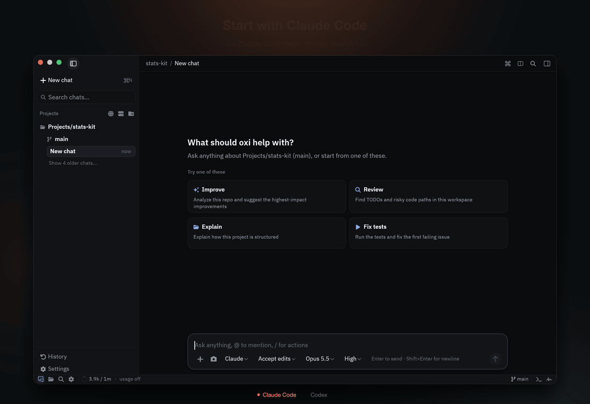
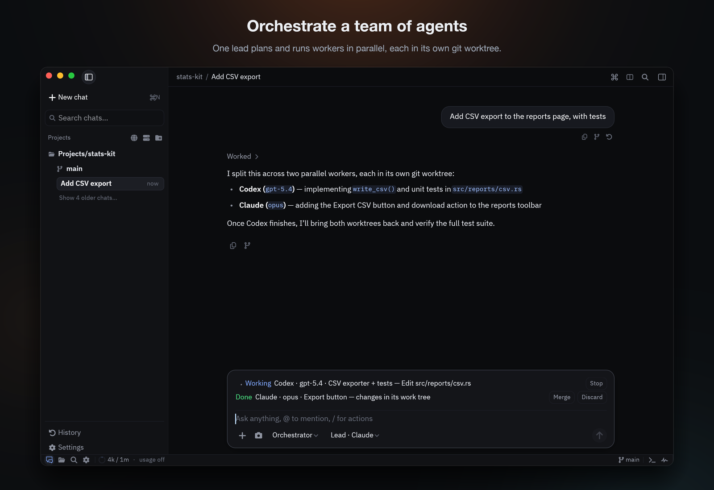
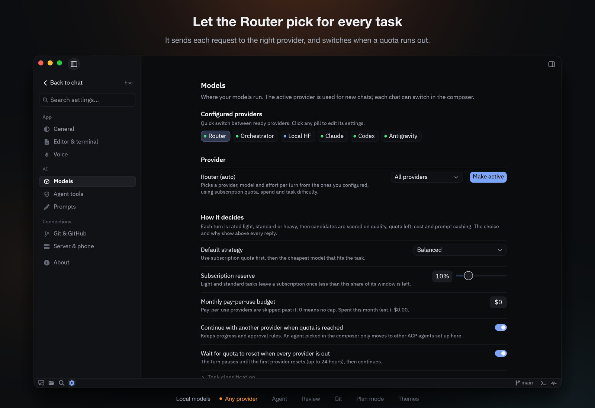
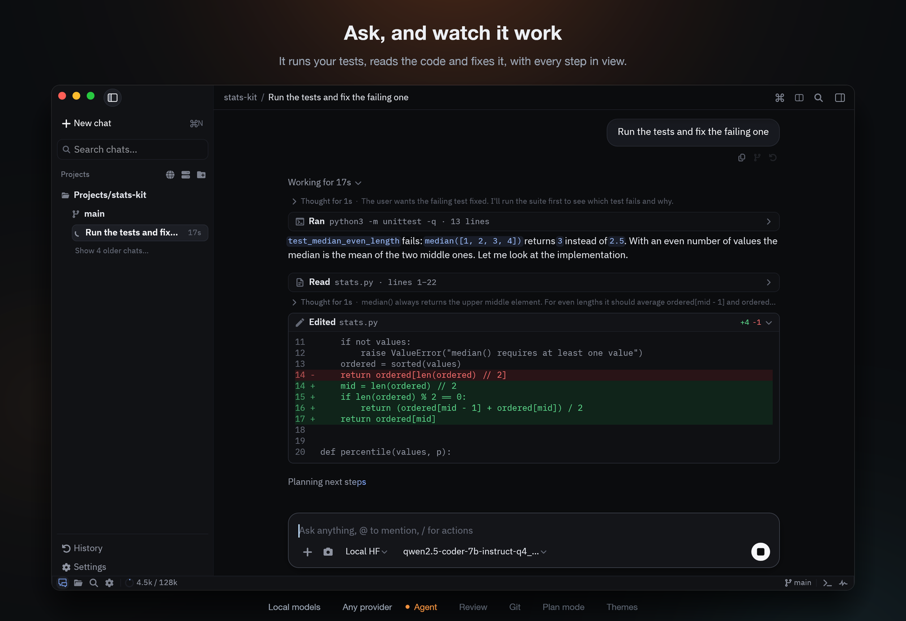
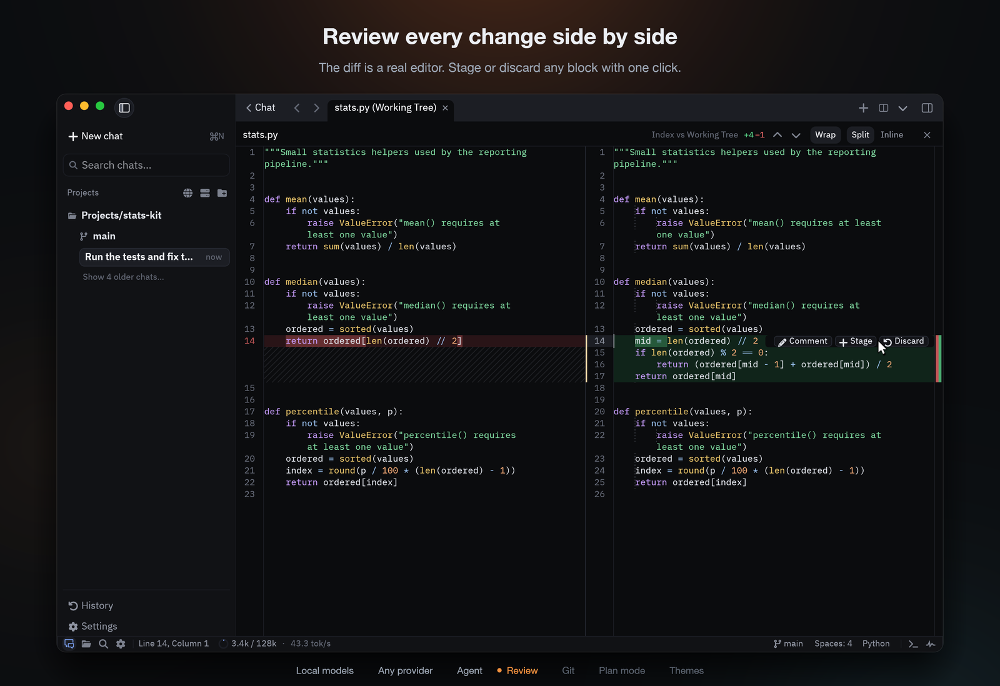
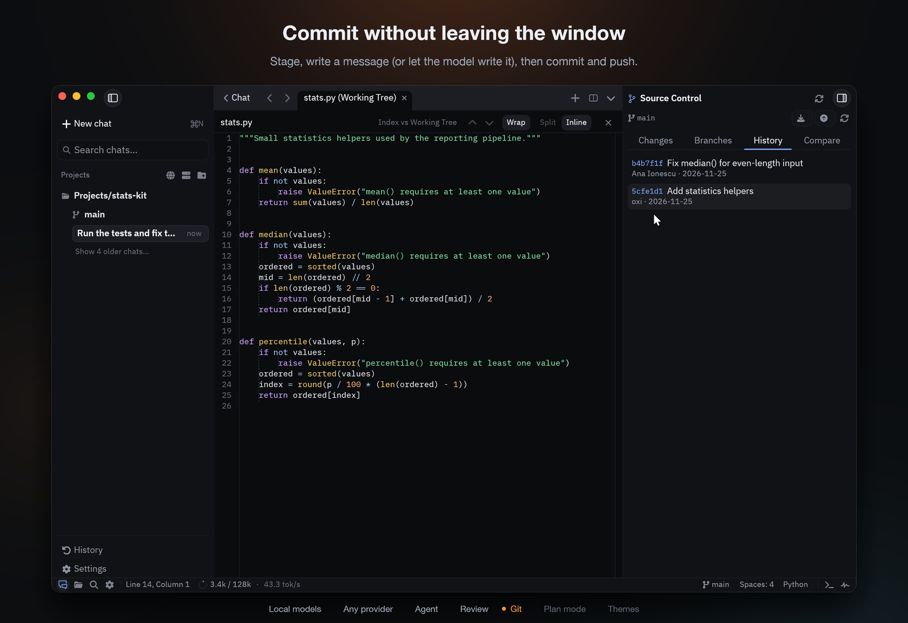
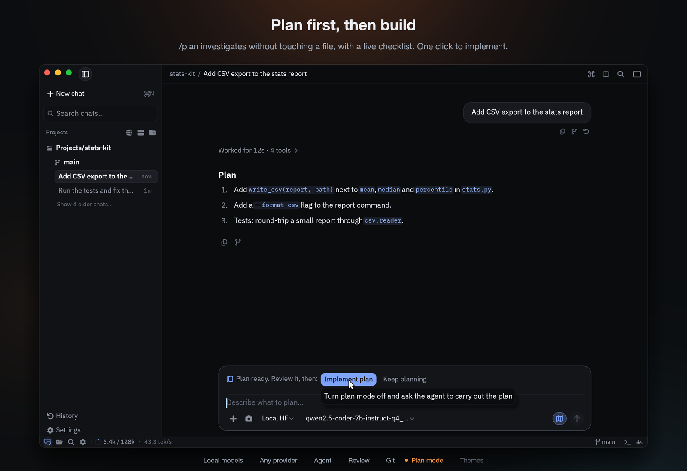
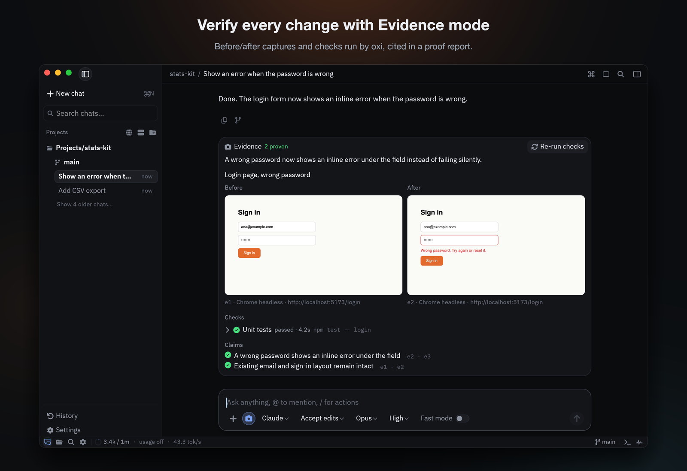
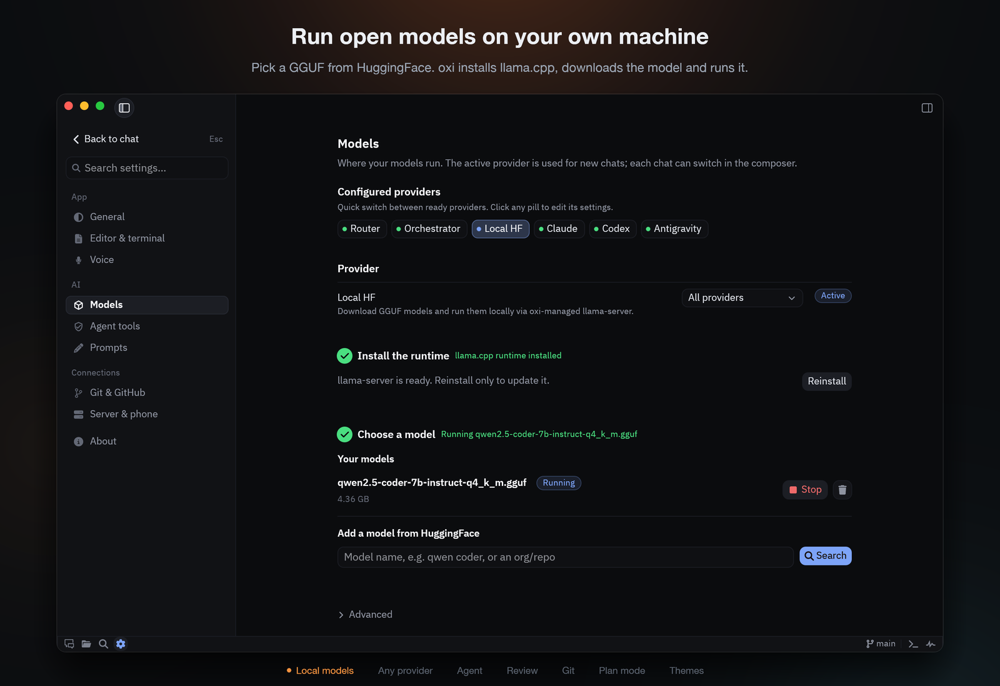

<p align="center">
  
</p>

<h1 align="center">oxi</h1>

<p align="center">
  <b>Claude Code, Codex, Antigravity, Cursor, GitHub Copilot, OpenCode, and Muse Code in one workspace.</b><br />
  Switch agents mid-chat with full context, run multi-agent Orchestrator teams in parallel worktrees, or run local open models on your own machine.<br />
  One Rust binary. No Electron, no account, around 70 MB of RAM.
</p>

<p align="center">
  <a href="#install"><b>Install</b></a> ·
  <a href="https://maziluiosif.github.io/oxi/">Website</a> ·
  <a href="#what-you-get">Features</a> ·
  <a href="https://github.com/maziluiosif/oxi/releases/latest">Latest release</a>
</p>

<p align="center">
  <a href="https://github.com/maziluiosif/oxi/releases/latest"></a>
  
  <a href="https://github.com/maziluiosif/oxi/actions/workflows/ci.yml"></a>
  <a href="LICENSE"></a>
</p>

<p align="center">
  
  <br />
  <sub>Recorded from the real app. More in the <a href="https://maziluiosif.github.io/oxi/#demo">one-minute tour</a>.</sub>
</p>

## Install

**macOS (Apple Silicon) and Linux (x86_64):**

```bash
curl -fsSL https://maziluiosif.github.io/oxi/install.sh | sh
```

**Windows (x86_64), in PowerShell:**

```powershell
irm https://maziluiosif.github.io/oxi/install.ps1 | iex
```

Then run `oxi` inside a project folder, or open it from your apps menu. To update, run `oxi update` or the same command again.

If Sublime Text is installed, the same command adds oxi's [Sublime Text package](editors/sublime/README.md) too.

<details>
<summary>Homebrew, manual download, install options</summary>

### Homebrew (macOS, Linux)

```bash
brew tap maziluiosif/tap
brew install --cask oxi
xattr -cr /Applications/oxi.app   # macOS only, once after installing
```

### Manual download

Get the archive for your platform from [Releases](https://github.com/maziluiosif/oxi/releases) and extract it. On macOS, move `oxi.app` to `/Applications` and run `xattr -cr /Applications/oxi.app` once, because the app is not notarized by Apple. On Windows, click **More info → Run anyway** the first time.

### Install options

| Variable | Effect |
|---|---|
| `OXI_VERSION` | Install a specific release, e.g. `v1.48.0` |
| `OXI_BIN_DIR` | macOS/Linux: where the `oxi` command goes (default `~/.local/bin`) |
| `OXI_APP_DIR` | macOS: where `oxi.app` goes (default `/Applications`) |
| `OXI_INSTALL_DIR` | Windows: install folder (default `%LOCALAPPDATA%\Programs\oxi`) |
| `OXI_SUBLIME` | `1` always installs the Sublime Text package, `0` never does |

</details>

<details>
<summary>Build from source</summary>

You need **Rust 1.92+** ([rustup](https://rustup.rs)) and C/C++ build tools.

```bash
git clone https://github.com/maziluiosif/oxi
cd oxi
cargo run --release
```

#### Windows prerequisites

```powershell
winget install --id LLVM.LLVM -e
winget install --id Kitware.CMake -e
```

Also install Visual Studio Build Tools with the **Desktop development with C++** workload. If the build can't find `libclang`, set:

```powershell
[Environment]::SetEnvironmentVariable("LIBCLANG_PATH", "C:\Program Files\LLVM\bin", "User")
```

</details>

## Your first five minutes

1. **Open a project.** Run `oxi` in its folder, or use **Open folder…** in the sidebar.
2. **Pick a model** in **Settings → Models**:
   - **Already have an agent subscription?** Choose **Claude Code**, **Codex**, **Antigravity**, **Cursor**, **GitHub Copilot**, **OpenCode**, or **Muse Code** under External agents and click **Make active**. It uses your existing login.
   - **Have an API key?** Add it under **OpenAI**, **OpenRouter**, **Azure OpenAI**, **OpenCode Go**, **Meta Muse**, **Anthropic-compatible**, or **GPT Codex**.
   - **Free and private:** choose **Local HF**, click **Install runtime**, download a model (the usual choice is marked), and click **Run**.
3. **Ask for something real:** *"Run the tests and fix the failing one."*
   - Type `/plan` to investigate and map out a change before editing files.
   - Use `/evidence` when you want captured before/after proof and verified checks.
   - Run `/learn` to turn corrections from a chat into reusable project rules.
   - Pick **Orchestrator** when a task is big enough to split across a team of agents in parallel.

## What you get

<table>
  <tr>
    <td width="50%" valign="top">
      
      <b>Orchestrate a team of agents.</b> Pick a lead agent and let it split substantial work across parallel workers from your configured providers. Concurrent editors run in isolated git worktrees and merge back as uncommitted changes for you to review, with automatic quota-aware rerouting when a subscription runs low.
    </td>
    <td width="50%" valign="top">
      
      <b>Any provider, or all of them.</b> Claude Code and Codex run directly on their native CLIs; Antigravity (<code>agy acp</code>), Cursor, GitHub Copilot, OpenCode, and Muse Code connect over ACP; plus ChatGPT sign-in, local models, or any API. Router picks the right model per turn and fails over when quota runs out.
    </td>
  </tr>
  <tr>
    <td width="50%" valign="top">
      
      <b>An agent that shows its work.</b> Reads, searches and edits code, runs commands, searches the web, and calls MCP servers. Includes <code>@mention</code> fuzzy file chips, live mid-turn steering &amp; queuing, interactive question forms, background task tracking, checkpoints &amp; rewind, and linked subagent/workflow transcripts.
    </td>
    <td width="50%" valign="top">
      
      <b>Review in a real diff editor.</b> Side by side or inline, editable, with soft word wrap, Stage/Discard per hunk, and inline diff line comments sent together to the agent. Includes image diff (side-by-side &amp; swipe divider), Chat + Editor side-by-side split view, go to definition, find &amp; replace, minimap, and tabs.
    </td>
  </tr>
  <tr>
    <td width="50%" valign="top">
      
      <b>Git and worktrees built in.</b> Compact Source Control with inline sync, Stage all &amp; Commit (<code>Cmd/Ctrl+Enter</code>), branch management, pull request dialogs, and AI commit messages (using your existing Claude Code, Codex, or Antigravity CLI login too). First-class git worktrees with per-repo setup scripts and safe removal checks.
    </td>
    <td width="50%" valign="top">
      
      <b>Plan first, then build.</b> <code>/plan</code> investigates without changing a file, with a live checklist. One click implements it.
    </td>
  </tr>
  <tr>
    <td width="50%" valign="top">
      
      <b>Evidence mode.</b> Click the camera or send <code>/evidence</code> so the agent captures before/after screenshots or recordings, runs checks through oxi, and cites verified proof in a report beneath its reply.
    </td>
    <td width="50%" valign="top">
      
      <b>Local models, set up for you.</b> Pick a GGUF from HuggingFace and oxi installs <code>llama-server</code>, downloads it and runs it—locally or on a GPU box over SSH. LM Studio, Ollama, and llama.cpp work too.
    </td>
  </tr>
</table>

### More built in

- **Multi-agent orchestration & delegation:** Configure **Settings → Models → Orchestrator** to give a `#lead` chat team tools (`team`, `spawn_workers`, `worker_status`, `worker_diff`, `message_worker`, `merge_worker`, `stop_worker`). Read-only workers and a lone editor run in the workspace; concurrent editors get isolated git worktrees with 3-way merge handoff back as uncommitted changes, plus quota-aware rerouting when a subscription runs low. Regular chats also support cross-provider `delegate_task`, and ACP subagents and Claude Workflows appear as folded linked transcripts ([Subagent conversations](docs/SUBAGENTS.md)).
- **Slash commands & learned project rules:** Built-in `/new`, `/compact`, `/plan`, `/evidence`, and `/learn [focus]`, plus any dynamic slash commands advertised by the active agent. `/learn` distills corrections from the chat into numbered candidate rules saved to `.oxi/rules/learned.md`—git-excluded and shared across worktrees.
- **Cross-chat recall & scratchpad:** Agents can search across saved workspace chats (`chat_search`), fetch earlier turns omitted from context (`chat_read`), and read or update the global autosaved scratchpad (which can also be saved to a file).
- **Checkpoints, crash recovery & live steering:** Git-ref checkpoints (`refs/oxi/checkpoints/`) let you rewind a chat to any turn and optionally restore files even after a restart. Active turns are journaled so restarts report what may have changed. Steer running turns mid-flight or queue follow-ups, track background commands across turns, and attach to running Claude Code sessions.
- **Split views & workspace UI:** Side-by-side Chat + Editor split, Split Chat with mirrored "Send to both" prompt mode, breadcrumb header with inline title rename, sidebar history filters and period pills, status bar context popover with clickable subscription quotas and live output speed (`tok/s`), Copy/Fork/Rewind reply actions, floating toasts, session import, and recursive folder deletion with unsaved-file protection.
- **Optional Computer use:** Opt-in `agent-desktop` MCP toggle in **Settings → Agent tools**. oxi automatically downloads and SHA256-verifies `vercel-labs/agent-desktop`, syncs it to remote SSH hosts, and blocks desktop actions in Plan mode.
- **Themes, fonts & extras:** Seven built-in themes (**Antigravity** default, Dark, Light, Midnight, Zed, Sublime, Sublime 4) plus custom JSON themes in `<config>/oxi/themes/`, bundled **IBM Plex Sans** and **Lilex** fonts, local Whisper voice dictation, custom system prompts, and keyless web search (DuckDuckGo, Bing, or SearXNG).

<details>
<summary>How Evidence mode verifies claims</summary>

Click the camera in the composer or send `/evidence` to toggle it; `/evidence <task>` enables it and sends the task. ACP agents and API/local models that support tool calls can capture before/after images or recordings, run checks, and cite them in a report beneath their response. oxi records check results and flags missing or contradicted claims, requesting missing evidence at most twice.

You can enable or disable Evidence mode while the agent is answering: the live choice applies when that response finishes. Informational replies with no workspace changes do not trigger automatic verification, though unverified edits from earlier in the conversation can still need proof. Existing reports in the same chat are reused when their cited checks and captures cover the exact current workspace state; later changes invalidate that proof, and older reports without workspace version metadata are not assumed to cover the current state.

Commands use the usual shell approvals and, for API/local providers, the configured command timeout. Plan mode takes precedence. Capturing a URL needs a Chromium browser; screen and window capture depend on OS support and permissions. A model can produce captures without vision, but cannot inspect their contents unless images are supplied to a vision-capable model. Headless clients can set `evidence: true` or `false` on `prompt.send`; subsequent turns in that chat retain the choice until it is changed or the chat is reloaded.

</details>

## Models and providers

Pick a provider in **Settings → Models** or from the model picker in the composer.

| Provider | |
|---|---|
| **Orchestrator** | A lead agent coordinates parallel workers across your configured providers in isolated worktrees |
| **Router** | Picks one of your providers per turn and fails over when quota runs out |
| **Claude Code, Codex** | Connects directly to their native CLIs using your existing login (legacy ACP override supported) |
| **Antigravity** | Auto-detects an installed `agy` CLI (`agy acp`) or downloads the official ACP server on first use; Google sign-in or Gemini key, with effort controls and optional quota tracking |
| **Cursor, GitHub Copilot, OpenCode, Muse Code** | Uses your existing subscription/login through ACP |
| **GPT Codex** | ChatGPT OAuth sign-in (port `1455`), or an OpenAI API key |
| **OpenAI, Azure OpenAI, OpenRouter, OpenCode Go, Meta Muse, Anthropic-compatible** | Hosted APIs with your key |
| **Local HF / Remote HF** | Managed `llama-server` locally or on another machine over SSH |
| **LM Studio, Ollama, llama.cpp** | Your own local or LAN server, optionally over SSH |

With Router you can also override it naturally in chat: *"use Codex for this"* or *"from now on use Claude Code"*.

<details>
<summary>Default URLs and environment variables</summary>

| Provider | Default base URL | Key from environment |
|---|---|---|
| OpenAI | `https://api.openai.com/v1` | `OPENAI_API_KEY` |
| Azure OpenAI | `https://YOUR_RESOURCE.openai.azure.com/openai/deployments/YOUR_DEPLOYMENT` | `AZURE_OPENAI_API_KEY` (API version via `AZURE_OPENAI_API_VERSION`, default `2024-10-21`) |
| OpenRouter | `https://openrouter.ai/api/v1` | `OPENROUTER_API_KEY` |
| GPT Codex | OAuth (port `1455`), or `https://api.openai.com/v1` with a key | `OPENAI_API_KEY` |
| OpenCode Go | `https://opencode.ai/zen/go` | `OPENCODE_GO_API_KEY`, `OPENCODE_API_KEY` |
| Meta Muse | `https://api.meta.ai/v1` | `MODEL_API_KEY` |
| Custom Anthropic | `http://localhost:8000` | `CUSTOM_ANTHROPIC_API_KEY`, `ANTHROPIC_API_KEY` |
| LM Studio | `http://localhost:1234/v1` | `LMSTUDIO_API_KEY` (optional) |
| llama.cpp | `http://localhost:8080/v1` | `LLAMA_API_KEY` (optional) |
| Ollama | `http://localhost:11434/v1` | `OLLAMA_API_KEY` (optional) |
| Local HF / Remote HF | `http://127.0.0.1:18080/v1` | none |

External agents use their own CLI sign-in by default, and also accept optional API key environment variables when configured: `ANTHROPIC_API_KEY` (Claude Code), `CODEX_API_KEY` / `OPENAI_API_KEY` (Codex), `GEMINI_API_KEY` (Antigravity), `COPILOT_GITHUB_TOKEN` (GitHub Copilot), and `META_API_KEY` (Muse Code).

ChatGPT sign-in needs port `1455` free for the login callback. The Router's task classifier uses OpenRouter if a key is set, and falls back to local rules otherwise; you can turn it off in **Settings → Models → Router (auto)**.

</details>

## Remote workspaces over SSH

Connect the desktop app to another machine with **File → Connect to Remote Host…** or the server icon above the chat list. Choose an SSH host and a folder on it; agents, files, Git, and the terminal run on that host, and chats are saved there. `oxi server` also extracts text from attached documents (PDF, Word, Excel, PowerPoint, and OpenDocument) so agents can read them directly.

Install the same oxi build on both machines. On a macOS host, run `oxi server install` once from its logged-in desktop session. The client uses your existing SSH keys or `ssh-agent`; first check that `ssh -o BatchMode=yes your-host true` succeeds.

See [Remote SSH setup](docs/remote-ssh.md) for installation, credentials, and troubleshooting.

## Your agents on your phone

Run `oxi server` on a machine you keep on (**Settings → Server & phone**, or `oxi server install`), then pair the oxi Android app (`oxi-android.apk` in each release) by scanning the QR code over Tailscale (or `--lan` on a trusted local network).

The Android app supports camera, file, and share attachments; background notifications with direct **Reply** and **Allow/Deny** actions; interactive agent question forms; Evidence mode; a Source Control panel with diffs and AI commit messages; agent checklists and context usage; persistent drafts; and automatic self-updates. See [oxi server](docs/server.md).

## Your data

Local workspaces keep their data on your machine; remote workspaces keep chats and project files on their SSH host. Session saves use atomic, crash-safe writes. Settings live in your config folder (e.g. `~/.config/oxi/settings.json` on Linux), next to `oxi.log` and, if oxi ever crashes, `crash.log` (**Settings → About** opens them).

The desktop app stores API keys, sign-in tokens, and SSH passwords in the system keychain (macOS Keychain, Windows Credential Manager, Secret Service on Linux), never in the settings file. The managed server (`oxi server install`) uses an owner-only `server-secrets.json` file in its config folder to avoid keychain prompts after updates; see [server credentials](docs/remote-ssh.md#credentials).

oxi loads workspace instructions from `AGENTS.md` at the repo root, `.oxi/rules/` (including rules saved by `/learn`), and `.cursor/rules/`.

## Good to know

- Approval prompts are the real safety boundary. Shell commands and MCP tools are not sandboxed.
- You can adjust per-tool confirmation policies in **Settings → Agent tools**.
- **Computer use** (`agent-desktop`) is off by default; when explicitly enabled, desktop actions run without per-action approval prompts outside Plan mode.
- Only point SSH tunnels at machines you control.
- Image input depends on whether your model supports images.

## Contributing

See [CONTRIBUTING.md](CONTRIBUTING.md) for building, tests, code layout, and PR conventions.
